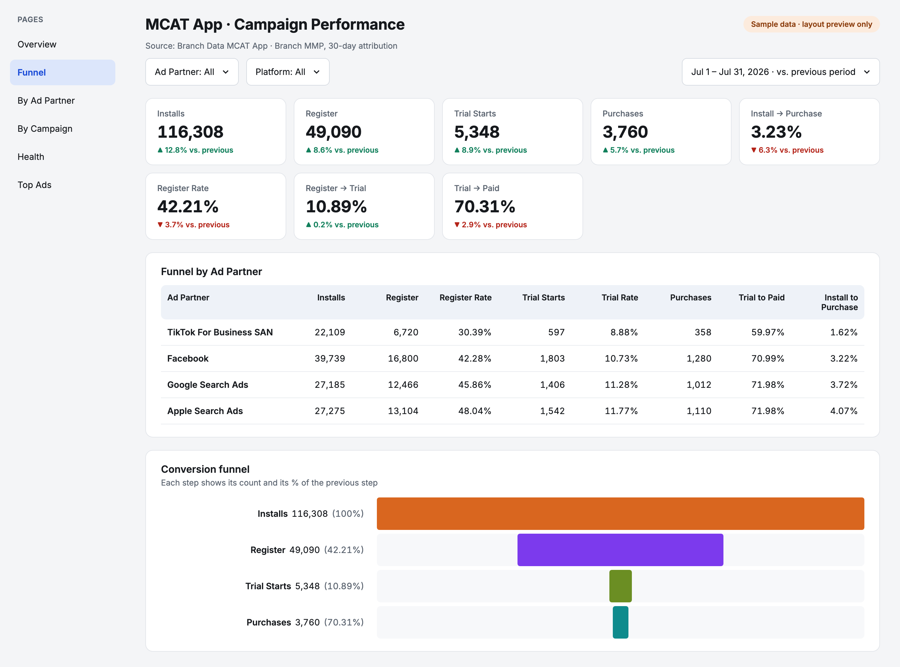
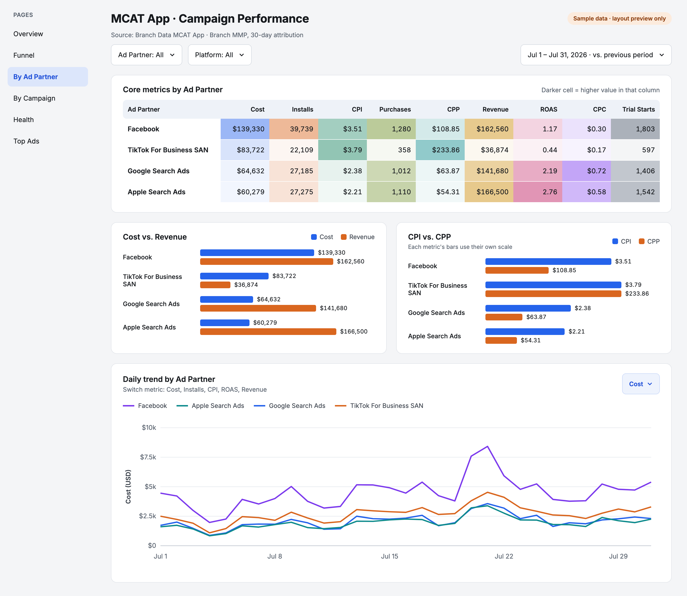
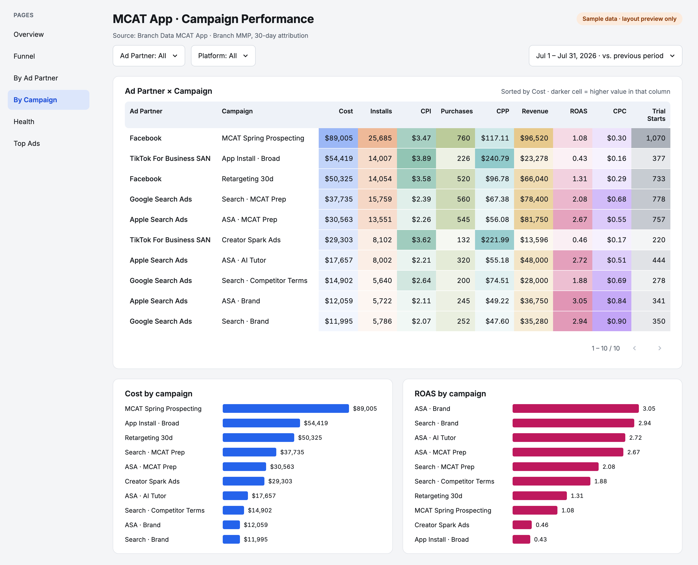
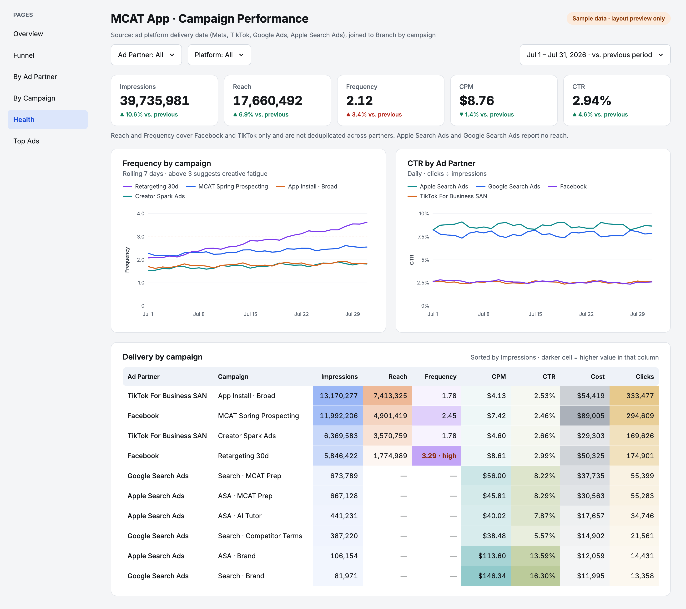
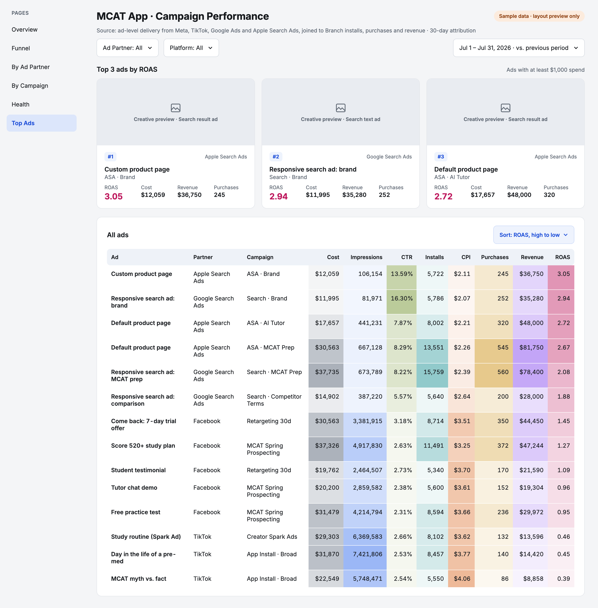

# KOTC Marketing

A daily marketing data pipeline supporting cross-channel paid advertising reporting. Campaign data from the Branch MMP flows through BigQuery into a Looker Studio dashboard covering cost, the install-to-purchase funnel, ad partners, campaigns and top ads. It sends daily Slack reports on app install campaigns, flagging underperforming ads.


```text
meta-monitor/   Daily and weekly Slack report from the Meta Marketing API
                flags ads whose 7-day CPI is above the threshold
                pause_flagged_ads.py can turn those ads off
dashboard/      Branch → BigQuery loader for the dashboard data
```

## Slack daily report

Posted every morning for yesterday's Meta app install campaigns, followed by a list of ads whose CPI over the past 7 days is above the threshold. Example with sample data and a $5 threshold:


## Demo dashboard

[MCAT App Campaign Performance Dashboard Demo](https://lookerstudio.google.com/reporting/41c3492f-5bfd-42f8-bf50-79a8c8802ca2) (Looker Studio, sample data)

Every number is simulated: one month of about $350k spend across Facebook, TikTok, Google Search Ads and Apple Search Ads, compared with the previous period.

**Overview**: ten key metrics with the change vs. the previous period, and the daily cost trend.


**Funnel**: Installs → Register → Trial Starts → Purchases, with step rates and a breakdown by ad partner.



**By Ad Partner**: core metrics by partner, cost vs. revenue, CPI vs. CPP, and daily cost by partner.



**By Campaign**: core metrics by campaign, with cost and ROAS rankings.



**Health**: impressions, reach, frequency, CPM and CTR, with frequency by campaign and CTR by partner.



**Top Ads**: the three best ads by ROAS and a ranked table of every ad.



## Running

Slack reports run on GitHub Actions:

- `daily-report.yml`: every day at 8:05 AM ET (yesterday's campaigns and 7-day CPI flags)
- `weekly-report.yml`: Fridays at 4:05 PM ET (past 7 days)

Preview locally:

```bash
cd meta-monitor
python scripts/preview_report.py
```

## Secrets

Do not commit `.env`, `local.env` or service-account JSON.

GitHub Actions: `META_ACCESS_TOKEN`, `SLACK_WEBHOOK_URL`
