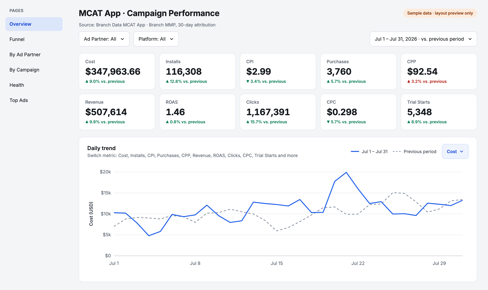
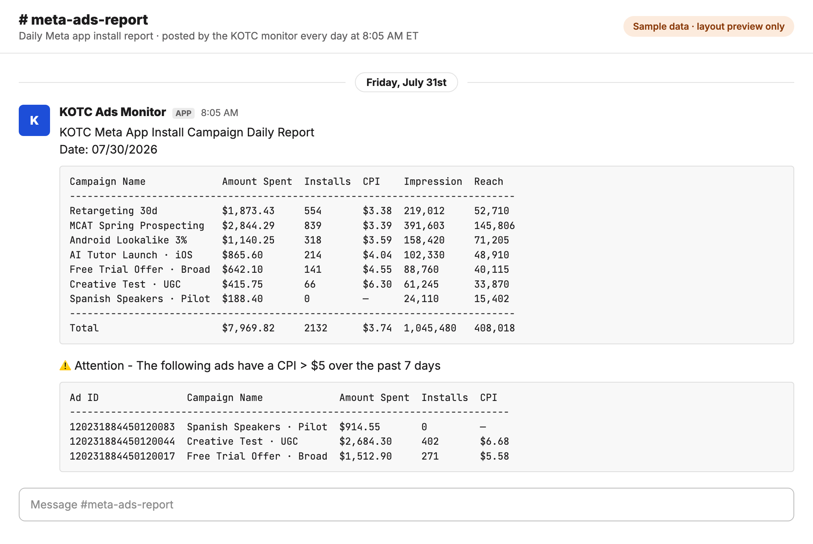

# KOTC Marketing

Marketing reporting for the KOTC MCAT app. Meta (Facebook & Instagram) app install campaigns are checked every day and summarized in Slack, with high-CPI ads flagged. Campaign data from the MMP (Branch.io) feeds a Looker Studio dashboard.


```text
meta-monitor/   Daily and weekly Slack report from the Meta Marketing API
                flags ads whose 7-day CPI is above the threshold
                pause_flagged_ads.py can turn those ads off
dashboard/      Branch → BigQuery loader for the dashboard data
```

## Demo dashboard

[MCAT App Campaign Performance Dashboard Demo](https://lookerstudio.google.com/reporting/41c3492f-5bfd-42f8-bf50-79a8c8802ca2) (Looker Studio, sample data)

Pages: Overview, Funnel (Installs → Register → Trial Starts → Purchases), By Ad Partner, By Campaign, Health (impressions, reach, frequency, CPM, CTR) and Top Ads. Every number is simulated: one month of about $350k spend across Facebook, TikTok, Google Search Ads and Apple Search Ads, compared with the previous period.



## Slack daily report

Posted every morning for yesterday's Meta app install campaigns, followed by a list of ads whose CPI over the past 7 days is above the threshold. Example with sample data and a $5 threshold:



## Running

Slack reports run on GitHub Actions:

- `daily-report.yml`: every day at 8:05 AM ET (yesterday's campaigns and 7-day CPI flags)
- `weekly-report.yml`: Fridays at 4:05 PM ET (past 7 days)

Preview locally:

```bash
cd meta-monitor
python scripts/preview_report.py
```

## Secrets

Do not commit `.env`, `local.env` or service-account JSON.

GitHub Actions: `META_ACCESS_TOKEN`, `SLACK_WEBHOOK_URL`
