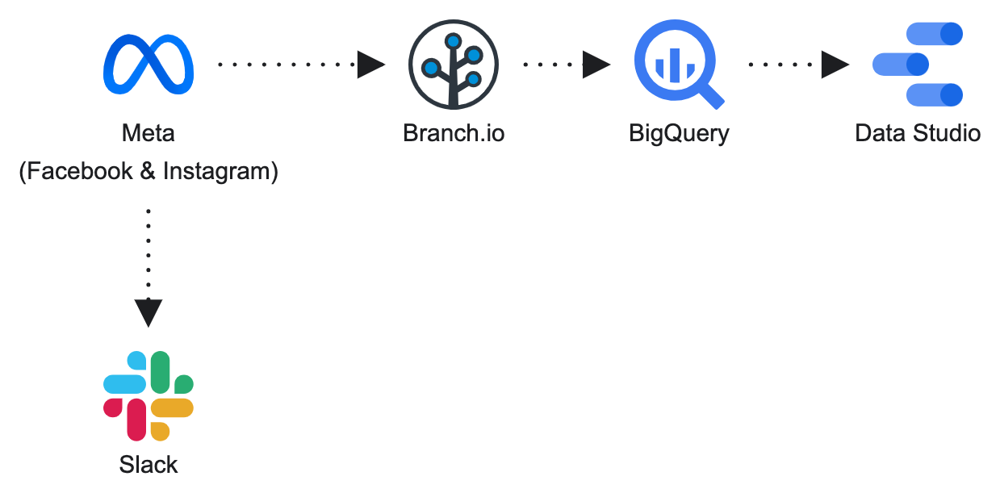

# KOTC Marketing

This repo monitors Meta ads, sends a Slack report, and flags and turns off underperforming ads. It also connected the MMP (Branch) to BigQuery for the Data Studio dashboard — that pipeline is retired as of 2026-11-02 (see below).

Local folder and GitHub repo are the same name: `kotc-marketing`.

```text
meta-monitor/   Slack daily + weekly report (running)
                flag 7-day CPI > $8
                pause_flagged_ads.py (not running)

dashboard/      Branch → BigQuery (retired 2026-11-02)
                inbox drag-and-drop watcher (removed)
                branch_to_bigquery.py (not running)
```

Data Studio Dashboard: [KOTC Performance Dashboard](https://datastudio.google.com/reporting/317a5d82-23e2-4d51-9d52-1c692aa953fc/page/mkyEE)

## Current status (2026-11-02)

No new Branch data will be added. The final Branch data lives in the Google Sheet [Branch Data MCAT App](https://docs.google.com/spreadsheets/d/1-H_EV3dqF62blGc4p2F7CwQvInbGbgQT7TvsFmkgnhs/edit) (`Sheet1`):

- 13,703 rows, 2024-04-15 → 2026-09-30, same columns as the old BigQuery table.
- Checked row by row against BigQuery on 2026-11-02: identical, except BigQuery `NULL`s are `0` in the Sheet.
- The BigQuery free trial is ending. A full export of `branch.daily_campaign_metrics` is kept locally at `dashboard/bigquery/data/bq_backup_branch_daily_campaign_metrics_2026-11-02.csv` (gitignored).
- The inbox LaunchAgent (`com.kotc.branch-inbox-watch`) was uninstalled.

Dashboard pages and their data:

Both sheets the dashboard reads are owned by vivienneyang710@gmail.com:

| Data Studio data source | Sheet | Used by |
|---|---|---|
| `MCAT App` | [Branch Data MCAT App](https://docs.google.com/spreadsheets/d/1-H_EV3dqF62blGc4p2F7CwQvInbGbgQT7TvsFmkgnhs/edit) (through 2026-09-30) | MCAT Overall, MCAT Campaign, Magnitude Digital, and the NCLEX page's Ad Partner / Platform dropdowns |
| `NCLEX` | [Branch Data NCLEX](https://docs.google.com/spreadsheets/d/1ljZzZ1Cfh_yGYEiylCFl1XdaUE7h8hDr5pSqftBBaiY/edit) | NCLEX Overall charts |

The dashboard never read BigQuery directly. Until 2026-11-02 it read copies of these sheets owned by another account (MCAT: `1hTAv0HCI…`, which stopped at 2026-07-29; NCLEX: `1G0OYssa…`, identical to the new one, 723 rows), and MCAT Overall was broken: 4 components were on a Supabase PostgreSQL source (`daily_campaign_metrics`) and its CPI / CPP / CPC formulas used the Supabase field names. On 2026-11-02:

- `MCAT App` and `NCLEX` were reconnected to the sheets above; the Magnitude page picks up Aug–Sep 2026 as a result.
- The 4 Supabase components were moved to `MCAT App`; every CPI / CPP / CPC formula is now `SUM(Cost) / SUM(Installs | Purchases | Clicks)`.
- MCAT Overall's default date range is "Auto" (all data) instead of the last 30 days.
- MCAT Campaign: the Meta table's CPI is `SUM(Cost) / SUM(Installs)` (it was summing per-row ratios) and its duplicate CPI column is now Cost; the Apple Search Ads table got an `Ad Partner = Apple Search Ads` filter and a computed CPI.
- Totals were checked against the Sheet. The version before these changes is saved in Data Studio's version history as "Before Sheet fix 2026-11-02". `daily_campaign_metrics` (Supabase) is no longer used by any chart.

## Running

**Slack report** — GitHub Actions, preview locally:

- `daily-report.yml` — every day 8:05 AM ET (yesterday's campaigns + 7-day CPI flags)
- `weekly-report.yml` — Fridays 4:05 PM ET (past 7 days)

```bash
cd meta-monitor
python src/monitor.py
python scripts/preview_report.py
```

## Previous flow: Branch → BigQuery (retired)

How the dashboard data was loaded until 2026-11-02. The code is still in `dashboard/`; see [dashboard/README.md](dashboard/README.md).



**Inbox → BigQuery** — drop a Branch export into `inbox/` (or `dashboard/inbox/`). The watcher cleaned the file and appended its rows to `kotc-dashboard-auto-update.branch.daily_campaign_metrics`, then deleted the file:

```bash
cd dashboard
./scripts/setup_local.sh
./scripts/install_inbox_watch.sh
```

Appends were not de-duplicated, so overlapping exports left duplicate rows (40 date/partner/campaign/platform groups; the Sheet has the same ones).

## Not running

These programs exist but do not execute until you flip the flag:

- `meta-monitor/src/pause_flagged_ads.py` — `EXECUTE_PAUSE = False`
- `meta-monitor/src/meta_to_bigquery.py` — `EXECUTE_LOAD = False` (would write to BigQuery, which is retired)
- `dashboard/src/branch_to_bigquery.py` — `EXECUTE_LOAD = False` (no scheduled Branch sync)

## Secrets

Do not commit `.env`, `local.env`, or service-account JSON.

GitHub Actions (Slack): `META_ACCESS_TOKEN`, `SLACK_WEBHOOK_URL`  
Old inbox flow: `BRANCH_EMAIL`, `BRANCH_PASSWORD`, `GOOGLE_APPLICATION_CREDENTIALS` in `dashboard/.env`
